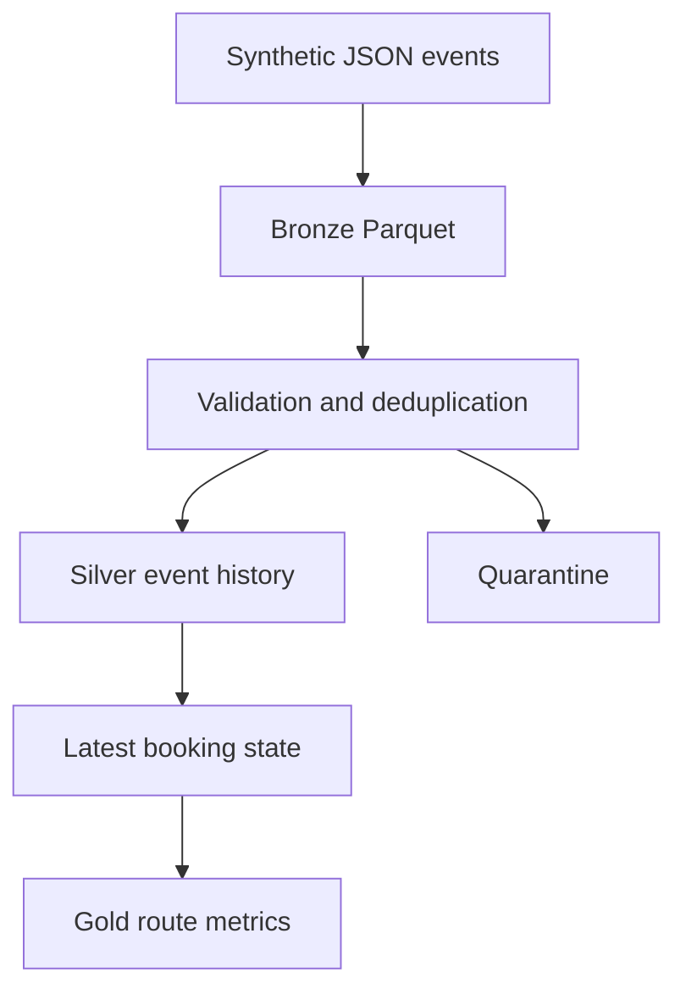

# Travel Booking Lakehouse

A runnable PySpark portfolio project that converts synthetic travel booking events into Bronze, Silver, and Gold Parquet datasets. It demonstrates data quality checks, deterministic event deduplication, latest booking state, and route revenue analytics.

## Quick start

Requires Python 3.10+ and Java 17. Tested with PySpark 3.5.6.

```bash
python -m venv .venv
source .venv/bin/activate
pip install -r requirements.txt
python pipeline.py
python -m unittest -v
```

On Windows activate with `.venv\Scripts\activate`. Run commands from the repository root.

## Data flow



The input includes a duplicate event, a cancellation, a negative amount, and an invalid timestamp. Invalid records go to quarantine. Event IDs are deduplicated by ingestion timestamp with content hash tie breaking. Booking state is selected by event time, ingestion time, and event ID. A cancellation removes the booking's earlier amount from confirmed revenue.

Expected sample quality: 8 input rows, 5 Silver events, 2 quarantined rows, 1 duplicate removed. ATL-JFK has $250 confirmed revenue and one cancellation. SFO-LAX has $180 confirmed revenue. All sample amounts are USD.

## Outputs

`output/bronze`, `output/silver`, `output/quarantine`, `output/gold`, and `output/quality.json`. Each Parquet folder contains Spark part files. Rerunning the same input overwrites the same local outputs instead of appending duplicates.

## Design choices and limits

This is a local batch demonstration. Each input is a complete event history; running only a daily delta would discard older state. Gold dates represent the latest event date, not the original booking date. Missing bookings are not treated as cancellations. Monetary values use doubles for the compact sample; production finance workloads should use fixed decimal precision and currency-aware aggregates. Full overwrite is convenient locally, but not an atomic lakehouse transaction. Delta/Iceberg MERGE, orchestration, cloud deployment, streaming, and scale benchmarks are future extensions, not implemented capabilities.

## Interview walkthrough

1. Explain why repeated events would inflate revenue.
2. Show why latest booking state must be calculated before aggregation.
3. Run the pipeline, inspect the quality report, and rerun to demonstrate repeatability.
4. Discuss late events, decimal money, partition design, and incremental MERGE as production extensions.

## Provenance

A new AI-assisted portfolio implementation for Bhavuk Jain using synthetic data. No employer code, private datasets, or production metrics. Review and adapt the code before representing personal implementation experience.

## References

- [Apache Spark DataFrame API](https://spark.apache.org/docs/3.5.6/api/python/reference/pyspark.sql/dataframe.html)
- [Apache Spark window functions](https://spark.apache.org/docs/3.5.6/api/python/reference/pyspark.sql/window.html)
